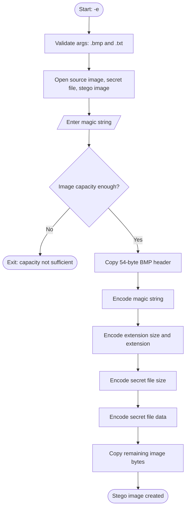
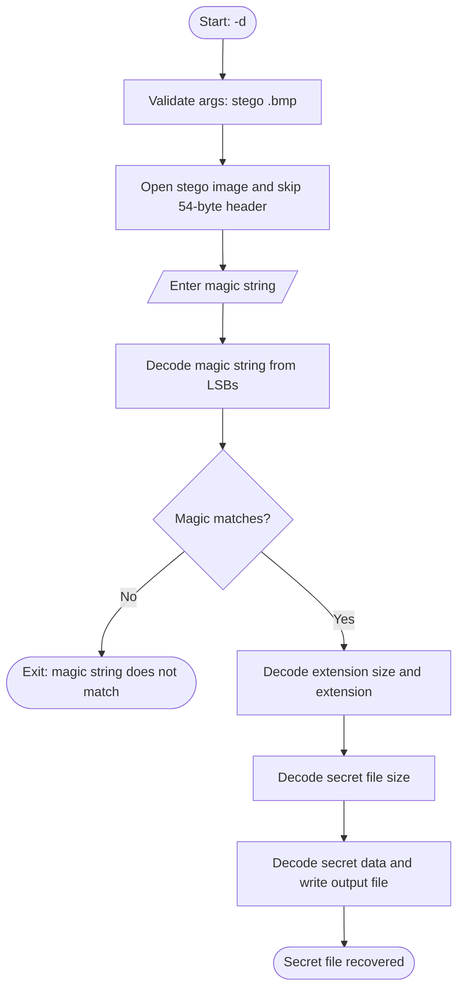

# Image Steganography in C (LSB Encoding)

A command-line tool written in **C** that **hides a secret text file inside a BMP image** using **Least Significant Bit (LSB) steganography**, and extracts it again later. The stego image looks the same to the human eye.

> Cover BMP + secret.txt + magic string → stego.bmp → decode → secret recovered

---

## Features
- **Encode**: hide a `.txt` file inside a `.bmp` image
- **Decode**: recover the hidden file from the stego image
- **Magic string** protection: decoding works only if you enter the correct password-like string
- **Capacity check** before encoding, so the secret never overflows the image
- Stores the secret file's **extension and size** inside the image, so the decoded file is rebuilt correctly
- Modular code (`encode`, `decode`, `main`, shared headers)

---

## How It Works

Each pixel byte of a BMP has a least significant bit that can be changed without visibly altering the image. The tool writes **1 bit of secret data into the LSB of 1 image byte**, so 1 secret byte needs 8 image bytes.

Data is stored in this order after the 54-byte BMP header:

| Order | Data | Image bytes used |
|---|---|---|
| 1 | Magic string | 8 per character |
| 2 | Secret file extension size | 32 |
| 3 | Secret file extension (e.g. `.txt`) | 8 per character |
| 4 | Secret file size | 32 |
| 5 | Secret file data | 8 per byte |
| 6 | Remaining image data | copied unchanged |

**Capacity:** a BMP can hide about `(width × height × 3) / 8` bytes. For example, a 1024×768 image can hold roughly 290 KB.

---

## Flowchart

### Encoding


### Decoding


---

## Project Structure

```
steganography/
├── main.c        # Entry point: picks encode or decode
├── encode.c/.h   # Encoding logic
├── decode.c/.h   # Decoding logic
├── common.h      # Magic string definition
├── types.h       # Status and operation enums
├── beautiful.bmp # Sample cover image
├── secret.txt    # Sample secret file
└── README.md
```

---

## Build and Run

**Requirements:** GCC

```bash
# Compile
gcc main.c encode.c decode.c -o stego

# Encode (stego image name is optional, default: stego.bmp)
./stego -e beautiful.bmp secret.txt [stego.bmp]

# Decode (output name is optional, default: output.txt)
./stego -d stego.bmp [output]
```

### Example session
```
$ ./stego -e beautiful.bmp secret.txt
You choosed encoding
BMP file is present
Text file is present
<------- Started Encoding ------->
Enter magic string: #*
Capacity checked successfully
Magic string encoded successfully
Secret data encoded successfully
Encoding successful

$ ./stego -d stego.bmp
<------ Started Decoding ------->
Enter the magic string: #*
Magic string decoded successfully
Secret data decoded successfully
Decoding successful
```

---

## Concepts Used
- Bitwise operators (AND, OR, shifts) and LSB manipulation
- File handling in binary mode (`fopen`, `fread`, `fwrite`, `fseek`, `rewind`)
- BMP file format (54-byte header, width and height at offset 18)
- Command-line arguments (`argc`, `argv`)
- Structures, enums and multi-file C programs

---

## Limitations
- Works only with **24-bit BMP** images (JPEG/PNG would destroy or change the hidden bits)
- Secret file must be a `.txt` file
- Magic string should be kept under 10 characters, since the decoder buffer is 10 bytes
- No encryption: the data is hidden, not scrambled, so anyone who knows the layout and magic string can read it
- Limited input validation and error handling

---

## Future Improvements
- Support any secret file type, not just `.txt`
- Encrypt the secret data before embedding
- Handle more image formats (PNG) and BMP variants
- Safer input handling and fuller error checks
- Add a progress display and an image-comparison (PSNR) check

---

## Author
**Harsh Kadam**: Mechatronics Engineering student (MMIT, SPPU), interested in embedded systems, robotics, and semiconductors.

⭐ If you found this project useful, consider giving it a star!
